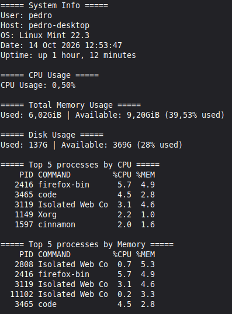

# Server Performance Stats
## Description
A Bash scripting project built as part of the roadmap.sh Server Performance Stats challenge.

The script displays basic system information and resource usage statistics for a Linux machine.

## Supported Enviroments
- Linux distros using Bash and procps/procps-ng utilities.
- Ubuntu, Debian and Fedora are intended targets.

## Prerequisites
- Git, to clone the repository
- Bash
- procps/procps-ng (top, free, ps)
- Standard command-line utilities (awk, df, grep, head, tail, cut, date, hostname, uptime, and whoami)

Most standard command-line utilities are already installed on typical Linux distributions.

## Limitations
- CPU usage parsing depends on the output format of top.
- Memory and process statistics depend on Linux utilities and their output formats.
- Other Unix-like operating systems are not currently supported or tested.

## Instructions
1. Clone repository
```bash
git clone https://github.com/pedro-bacellar/server-performance-stats-roadmap.sh
cd server-performance-stats-roadmap.sh
```
2. Make executable if necessary
```bash
chmod +x server-stats.sh
```

3. Run the script
```bash
./server-stats.sh
```

### Example Output


## Project [Requirements](https://roadmap.sh/projects/server-stats)

You are required to write a script server-stats.sh that can analyse basic server performance stats. You should be able to run the script on any Linux server and it should give you the following stats:

    Total CPU usage

    Total memory usage (Free vs Used including percentage)

    Total disk usage (Free vs Used including percentage)

    Top 5 processes by CPU usage

    Top 5 processes by memory usage